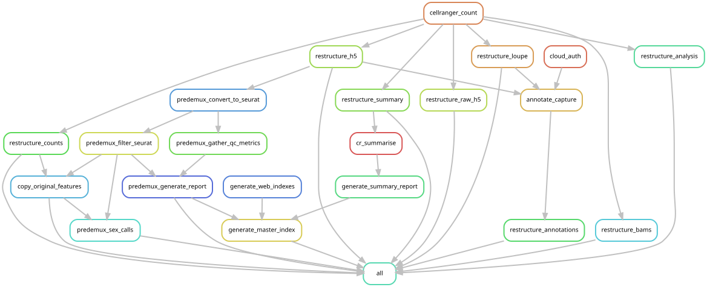
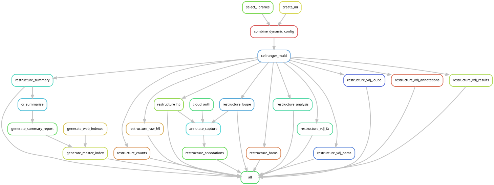

# Chromium Preprocessing

[](https://doi.org/10.5281/zenodo.23428424)

## Overview

A [Snakemake](https://snakemake.readthedocs.io/) workflow that pre-processes raw 10x
Genomics **Chromium** single-cell data by running **Cell Ranger** and tidying its outputs
into a consistent, analysis-ready layout with QC reports. It handles gene expression (GE),
feature barcoding (FB / CITE / HTO), and V(D)J assays, and can optionally aggregate pools,
pre-filter cells for demultiplexing, and annotate cell types.

Depending on the assays present it runs in one of two modes (see [Modes](#modes) and the
[rule graphs](#rule-graphs)): **count** (`cellranger count`, GE only) or **multi**
(`cellranger multi`, for FB/VDJ or HTO/OCM demultiplexing).

### Inputs

- **FASTQs** from one or more 10x Chromium captures (GE, and optionally FB and/or VDJ),
  DVC-tracked (see [Data preparation](#data-preparation)).
- **References** — a Cell Ranger GEX transcriptome and, for VDJ, a V(D)J reference
  (public 10x references, see [Reference data](#reference-data)).
- **Config** — `config.yaml`, `captures.csv`, `libraries.csv` (see [Config](#config)).

### Outputs

Per capture, a tidied Cell Ranger result tree under the configured results dir:
count matrices (`count/{filtered,raw}`), `h5`, `bam`, `loupe`, `cr_analysis`,
per-capture `summary/metrics`, optional `annotation` (cell types) and `predemux` outputs,
and a set of HTML QC reports indexed by a `master_index.html`.

### Contents

- [Rule graphs](#rule-graphs)
- [Tools](#tools)
- [Modes](#modes)
- [Data preparation](#data-preparation)
- [Config](#config)
- [Tests](#tests)
- [Status](#status)

## Rule graphs

The workflow runs in one of two modes depending on the assays present (see [Modes](#modes)).

### count mode (gene expression only)



### multi mode (feature barcode / VDJ, or HTO/OCM demux)



## Tools

The workflow uses three provisioning mechanisms, selected per rule. Runs enable all three
(`--use-singularity --use-conda --use-envmodules`, already set in the bundled profiles):

| Tool | Used for | How it's provided | Version |
|------|----------|-------------------|---------|
| **Cell Ranger** | `count` / `multi` / `aggr` / `annotate` | **environment module** (`module load cellranger/<version>`) | `9.0.1` (set in config `modules.cellranger`) |
| PBS submission helper | Cell Ranger cluster jobmode | environment module (`qsub/ext`) | site-provided |
| Apptainer/Singularity | container runtime | environment module (`module load singularity`) | site-provided |
| samtools | BAM merge in `cellranger_aggr` | container (`quay.io/biocontainers/samtools`) | `0.1.19` |
| csvkit | summary table assembly (`cr_summarise`) | conda (`workflow/envs/csvkit.yaml`) | `1.5.0` |
| R + Seurat / DropletUtils | predemux cell filtering & per-barcode sex typing | conda (`predemux.yaml`, `predemux_sex.yaml`) | R ≥ 4.2, Seurat 5.2 |
| Python + pandas / matplotlib / jinja2 | HTML reports, aggr CSV glue | conda (`html_reports.yaml`, `generate_aggr_csv.yaml`) | — |

Notes:

- **Cell Ranger is proprietary 10x Genomics software and is not bundled.** It must be
  installed separately and made available as an environment module named
  `cellranger/<version>` matching `modules.cellranger` in your config. It is used under 10x's
  own license.
- The **environment-module** mechanism (Cell Ranger, `qsub/ext`, singularity) is NCI-specific;
  on another site, provide equivalent modules or adapt the profiles under `profiles/`.
- **samtools is pinned to a very old 0.1.19** for the `cellranger_aggr` BAM merge. This pin
  predates the current maintainers; treat it as load-bearing until shown otherwise and
  re-validate the merge output before bumping it.
- Everything that *can* be sourced from public conda/containers is, so only Cell Ranger needs
  a manual install.

## Modes

This workflow can be run in either [standalone mode](#standalone-mode) or [module mode](#module-mode).

### Standalone mode

In "standalone" mode, the data to be processed by the workflow is included in the same repo as the workflow itself.
This mode is used mainly for [testing](#tests).
This repo includes test data, tracked via DVC under [test/data](test/data).
The [test config files](config/tests) tracked in this repo have been configured to run the workflow on this test data.

### Module mode

This workflow can also be embedded into a dataset as a [git submodule](https://www.atlassian.com/git/tutorials/git-submodule).
This is how the workflow is applied to real-world data.

To use this workflow in "module mode", first [create a dataset repo](https://github.com/swarbricklab/data_management/blob/main/SOP/dataset_creation.md) to host all of the data relevant to the project, as well as all of the code used to process that data (which may include other modules and/or scripts in addition to this workflow).

Then add this workflow as a git submodule under `modules/` and check it out recursively
(it carries a nested submodule for the shared PBS profiles):

```bash
git submodule add git@github.com:swarbricklab/chromium-preprocessing.git modules/chromium-preprocessing
git submodule update --init --recursive
```

The module is driven from the top of the dataset repo via `run_mod.sh` (see [Config](#config)
for which files to copy across).

Be sure to [prepare the data](#data-preparation) and [configure the workflow](#config) to process that data. 

## Data preparation

When used in module mode, all of the data to be processed by the workflow should be added to the dataset.
This includes:
- [raw data](#raw-data) (fastqs from 10X captures)
- [resources](#resources) (reference transcriptomes, etc)

This data should be dvc-tracked as part of a dataset that includes all of the data associated with that project.

### Raw data

> The registry-based import below is the **Garvan-internal** workflow (it relies on private
> Swarbrick Lab DVC registries and NCI paths). If you are running the workflow **standalone**
> outside Garvan, you do not need any of this — just place your 10x FASTQs on disk and point
> `deps.fastqs` / the libraries samplesheet at them (see the bundled [test config](config/tests)
> and [`prep.sh`](prep.sh) for a worked, fully public example).

The raw data should already be [registered](https://github.com/swarbricklab/data_management) in the appropriate registry.
If not, make a ticket in the [registries project board](https://github.com/orgs/swarbricklab/projects/5).
For this workflow, the relevant registry is [chromium](https://github.com/swarbricklab/chromium).

[Import](https://dvc.org/doc/command-reference/import) the data from the registry into the dataset as follows:
```
dvc import {registry} {path in registry} -o {path in dataset}
```
Here `{registry}` is the SSH git URL for the registry.
For example, URL for the `chromium` registry is `git@github.com:swarbricklab/chromium.git`

`{path in registry}` is the path to the data within the registry.
You can either look up the path in the [index](https://github.com/swarbricklab/chromium/blob/main/index.csv) or browse the official instance of the registry on NCI at the following path:
```
/g/data/dvc/instances/chromium
```
(This example is for the `chromium` registry.)
> Note: paths in the registry should be specified relative to the top of the registry.
> That is, paths should not start with `/g/data/` etc.

`{path in dataset}` is the location where you want to import the data into the dataset.
Typically, raw data will be imported to `data/fastqs` or similar.
In a multi-modal project (with single cell data and other modalities), you might want to add extra layers to organise data by modality.
For example: `data/sc/fastqs`

Importing data in this way will create `.dvc` files to track the import.
These `.dvc` files should be tracked via git in the dataset repository.

### Reference data

This workflow needs two 10x Genomics references for human poly-A captures:

- `resources/transcriptomes/refdata-gex-GRCh38-2020-A` — Cell Ranger GEX reference
- `resources/vdj/refdata-cellranger-vdj-GRCh38-alts-ensembl-7.1.0` — Cell Ranger V(D)J reference

Both are **public** and tracked via `dvc import-url` straight from 10x's own download
URLs (see `resources/**/*.tar.gz.dvc`), so they can be fetched without access to any
private registry. The references are distributed by 10x under 10x's own license;
`dvc update` re-fetches the tarballs **directly from 10x**, so each user obtains them
from the source (this repo does not re-host them).

Fetch the tarballs, then unpack them into the paths the config/rules expect:

```bash
# If you have access to the project's DVC remote:
dvc pull
# Or, without remote access, re-download straight from the public 10x URLs:
dvc update resources/transcriptomes/refdata-gex-GRCh38-2020-A.tar.gz.dvc \
           resources/vdj/refdata-cellranger-vdj-GRCh38-alts-ensembl-7.1.0.tar.gz.dvc

./prep.sh    # unpack the archives into place; the tarballs can then be deleted
```

Run `prep.sh` from the top of the repo (standalone) or of the super-project that mounts
this workflow as a module — the same place you run `run_mod.sh` / `run_test.sh`.

### Adding other resources (module mode)

For project-specific resources beyond the two bundled references (e.g. a different
transcriptome or a custom probe set), dvc-track them as part of the dataset repo. The
options, in order of preference:

1. [import](https://dvc.org/doc/command-reference/import) the resource from the
   [references](https://github.com/swarbricklab/references) registry (see the `10X/`
   folder in particular). If you cannot locate the resource you need there,
   [create an issue](https://github.com/swarbricklab/references/issues/new) to have it
   added — others likely need it too.
2. copy the resources from this repo to the dataset repo. Copy the entire `resources/`
   directory so the `.gitignore` files come across correctly; use `rsync` rather than
   `cp` to avoid clobbering existing files, then fetch the data:
   ```
   rsync -av --ignore-existing modules/chromium-preprocessing/resources resources/
   dvc pull -R resources
   ```
   Run this from the top of the dataset repo, assuming this workflow is installed as a
   git submodule at `modules/chromium-preprocessing/` (adjust the path if necessary).
3. add the resources directly to the dataset (last resort — prefer adding them to the
   [references](https://github.com/swarbricklab/references) registry so others benefit).

## Config

When using this workflow as a module, copy these files across to the super project.
For `{mode}` specify "count" if only gene expression (RNA) libraries are used, or "multi" if feature barcode (CITE/ADT/HTO) or VDJ libraries are also included.
```
cd {top of super project}
mkdir -p config/chromium-preprocessing
cp modules/chromium-preprocessing/config/templates/{mode} config/chromium-preprocessing 
```

To run this workflow, you will need to edit the following files within `config/chromium-preprocessing`:
- `config.yaml` ([template](config/templates/multi/config.yaml)) ([test config](config/tests/multi/config.yaml))
- `captures.csv` ([template](config/templates/multi/captures.csv)) ([test config](config/tests/multi/captures.csv))
- `libraries.csv` ([template](config/templates/multi/libraries.csv)) ([test config](config/tests/multi/libraries.csv))

Refer to the [configuration guide](config/README.md) for a detailed explanation and see the templates and test config linked above for examples.

## Re-running with additional captures

Adding captures to `captures.csv` / `libraries.csv` and re-running is *mostly*
incremental, but not entirely, and the exceptions are worth knowing before you start.

**Cell Ranger is correctly scoped.** `cellranger_count` runs only for captures whose
outputs are missing, so adding two captures to a 148-capture dataset costs two
Cell Ranger runs, not 150. The same holds for `annotate_capture` and the
`restructure_*` rules.

**The predemux chain is not.** `predemux_convert_to_seurat`, `predemux_filter_seurat`
and `predemux_gather_qc_metrics` write `temp()` outputs, and `predemux_generate_report`
aggregates them across every capture in the sheet. Once a run completes those
intermediates are deleted, so rebuilding that one report requires re-running all three
rules for *every* capture — plus `copy_original_features`, which cascades off the
regenerated filter outputs.

A worked example, adding 2 captures to a 148-capture dataset:

```
cellranger_count                2      <- the expensive rule, correctly scoped
annotate_capture                2
restructure_* (8 rules)         2 each
predemux_convert_to_seurat    150      <- temp() outputs, all rebuilt
predemux_filter_seurat        150
predemux_gather_qc_metrics    150
copy_original_features        150
                              ---
total                         626
```

This is usually acceptable. Measured from PBS accounting, the 148 redundant runs are
~44 s, ~60 s, ~18 s and ~7 s each respectively — about **49 SU in total** — and they sit
off the critical path, because they depend on `restructure_h5` outputs that already
exist. They run alongside Cell Ranger rather than delaying it. The critical path is
`cellranger_count` (~112 min) then `annotate_capture` (~23 min).

Check the plan before starting:

```bash
./modules/chromium-preprocessing/run_mod.sh -n --reason
```

### Do not reach for `--touch`

The reasons snakemake gives are `Missing output files`, not stale timestamps — the
`temp()` intermediates are genuinely gone. `--touch` cannot help with that: it only
marks existing files as current, and produces an identical 626-job plan. It is a no-op
here, not a shortcut.

### Under DVC

Datasets embedding this module usually wrap it in a DVC stage. DVC removes a stage's
outputs *before* re-running it, which deletes the Cell Ranger results for every capture
— turning a two-capture addition into a full rebuild of all 150.

`persist: true` on the stage outputs prevents that deletion:

```yaml
outs:
  - data/cellranger/count:
      persist: true
```

**Check your `cache.type` before doing this on a stage that holds BAMs.** `persist` does
not skip the pre-run removal; in `Stage.remove_outs()` it substitutes `unprotect` for
`remove`, and unprotecting a symlinked or hardlinked file byte-copies it back into the
workspace. With `cache.type = hardlink,symlink` that is a full copy of every file in the
stage's outputs, charged before any compute starts.

On a stage with 4.9 TB of outputs — 4.7 TB of it BAMs — this was an estimated **8 hours
of copying to avoid a 2 hour rebuild**, and would have duplicated 4.9 TB that the links
existed to share. With the default `cache.type=copy` there is no link to break and the
concern does not apply.

Where the unprotect pass costs more than the rebuild, run the workflow directly and
register the outputs afterwards:

```bash
./modules/chromium-preprocessing/run_mod.sh    # snakemake decides what to skip
dvc commit <stage>                             # record outputs DVC did not produce
```

The trade is that the stage is no longer reproducible purely through `dvc repro`. Worth
recording in the dataset repo when you make it.

## Per-barcode sex typing

When `params.extras.predemux` is on, `predemux_sex_calls` writes
`predemux/<capture>/sex_calls.csv` — one row per filtered barcode — from the
chrY-unique panel (`RPS4Y1, DDX3Y, UTY, USP9Y, EIF1AY, KDM5D`) and `XIST`. Sex is an
axis orthogonal to genotype clustering, so the call helps diagnose a male PBMC
spike-in that souporcell/freemuxlet miss when its cell fraction is tiny, and QCs
every demux run.

`sex_call` has five classes, deliberately keeping *conflict* and *no evidence*
distinct (they mean opposite things):

| class | meaning |
|-------|---------|
| `male` | chrY panel detected, XIST not |
| `female` | XIST detected, chrY panel not |
| `ambiguous` | **both** detected — conflict / likely cross-sex doublet |
| `no_signal` | callable depth but **neither** detected (XIST/chrY dropout) |
| `low_quality` | too shallow to sex-type (below the min UMI / gene depth) |

`no_signal` is usually the largest non-female class and is a *capture* limit, not a
tuning knob: XIST is a single lncRNA and the chrY panel is small, so shallow cells
often carry no sex-informative molecules at all (thresholds can't recover what was
never captured). `ambiguous` is the small, informative doublet-conflict class. For a
per-donor sex verdict, aggregate the confident `male`/`female` calls over a demux
group rather than reading per-cell classes directly.

Columns: `barcode, capture_id, chrY_counts, chrY_score, xist_counts, xist_score,
n_umi, n_genes, sex_score, sex_call, confidence`. `chrY_score`/`xist_score` are
`log1p(CP10K)` module scores; `sex_score = chrY_score - xist_score` (>0 male-leaning,
<0 female-leaning); `confidence` is the margin `|sex_score|`. The raw counts and
continuous scores are kept so thresholds can be re-tuned per use — strict for spike-in
removal, lenient for QC.

Thresholds are optional config under `params.predemux.sex.*` (see the
[template](config/templates/count/config.yaml)); omitting the block uses built-in
defaults. The reference must hard-mask the chrY PAR (as `refdata-gex-GRCh38-2020-A`
does) so PAR reads map to chrX and the chrY panel stays clean.

The rule reads the **persistent** filtered matrix (not the `temp()` rds) via its own
lightweight [`predemux_sex.yaml`](workflow/envs/predemux_sex.yaml) env, so adding or
re-tuning sex typing re-runs only `predemux_sex_calls` — no Cell Ranger, no Seurat
rebuild, and the other predemux rules are untouched.

> **Note on `speckle::classifySex`.** Issue #126 suggested it, but `classifySex` is not
> in the Bioconductor/bioconda `speckle` package (it lives only in the GitHub-only
> `Oshlack/speckle` / `phipsonlab/cellXY` repos) and returns only a bare `Male/Female/NA`
> label with no score or confidence. The call is therefore computed directly from
> XIST + the chrY panel, which is conda-native and emits the full continuous schema
> above; speckle is kept as the design reference, not a dependency.

## Tests

This module includes test data and a test script that verifies that the module can process this test data into the expected results.

### Test data

The [test](test) folder contains both the raw test data (under [test/data](test/data)) and the expected results (under [test/results](test/results)).

The input data is **public, de-identified 10x Genomics healthy-donor PBMC data**, deterministically downsampled so that `cellranger` runs on tiny fixtures:

- the **count** test (`tiny_pbmc`, 3 gene-expression captures) is downsampled from [`pbmc_1k_v3`](https://www.10xgenomics.com/datasets/1-k-pbmcs-from-a-healthy-donor-v-3-chemistry-3-standard-3-0-0) (1k PBMCs, 3' v3);
- the **multi** test (`tiny_pbmc2`, 2 captures × gene expression + antibody capture + VDJ-T) is downsampled from [`vdj_v1_hs_pbmc2`](https://www.10xgenomics.com/datasets/pbmcs-of-a-healthy-donor-5-gex-and-cell-surface-protein-1-standard-3-0-0) (healthy-donor PBMCs, 5' GEX + TotalSeq-C + V(D)J). The antibody panel in [`config/feature_barcode_reference.csv`](config/feature_barcode_reference.csv) is that dataset's published 17-plex TotalSeq-C feature reference.

The fixtures are DVC-tracked (`dvc pull -R test/data/`). They are *derived* artifacts: [`test/make_test_fixtures.sh`](test/make_test_fixtures.sh) reproduces them byte-for-byte from the public source tarballs and documents the exact downsampling, so no private data is required.

## Test config

As well as [template config](config/templates/), this repo includes [test config](config/tests/) for running the workflow on the test data bundled with this repo.

### Test script

The [run_test.sh](run_test.sh) script runs both tests and verifies the output against the
golden. It assumes:
1. the test data is available (`dvc pull -R test/data/`)
2. the golden is materialised (`dvc checkout test/results.dvc`)
3. a conda environment called `snakemake_7.32.4` is available

```bash
./run_test.sh                  # run count + multi, compare to the golden
./run_test.sh --update-golden  # run + compare, but keep the fresh output to bless a new golden
./run_test.sh -n               # dry-run (passthrough to snakemake; no comparison)
```

A real run stashes the committed golden, re-runs the workflow from scratch, then
content-compares the fresh output against the golden with
[`workflow/scripts/compare_to_golden.py`](workflow/scripts/compare_to_golden.py), exiting
non-zero if any meaningful output differs. The committed golden is restored afterwards
(unless `--update-golden` is given).

Cell Ranger output is **not bit-reproducible** out of the box: Loupe viewer files
(`.cloupe`/`.vloupe`) embed UUIDs, and Cell Ranger's own web summaries embed
numerically-nondeterministic secondary-analysis output (see below). The comparison checks
every file **except** those (which are checked for presence only), comparing `.gz` outputs by
decompressed content. This was calibrated empirically by running the test twice and diffing:
the count matrices, per-cell/summary CSVs, `.h5` matrices and VDJ references were all
byte-identical across runs (see issue #137).

Two sources of nondeterminism were *removed* rather than ignored, so the comparison covers
them too:

- **Reports.** This workflow's own HTML reports injected a wall-clock timestamp; it is now
  pinned via `SOURCE_DATE_EPOCH` (the reproducible-builds convention — see
  `workflow/scripts/cellranger_summary_utils.py`), which `run_test.sh` sets, so the reports
  are byte-stable and compared.
- **VDJ BAMs** (see below).

Cell Ranger's **own web summaries** (`web_summary.html` / `web_summary_cell_types.html`) stay
presence-only. They have no timestamp, and the restructure rules strip the absolute input
paths Cell Ranger bakes in (`sed "s|$(pwd)/||g"`, so the files are portable) — but the pages
also embed Cell Ranger's differential-expression table (gene order + floating-point
p-values/log-fold-changes) and cell-type table ordering, which vary run-to-run and can't be
normalised. The deterministic outputs they summarise are all content-compared regardless.
- **VDJ BAMs.** Cell Ranger assembles the same contigs/reads each run but emits them in a
  run-varying record order with a run-unique `@PG` path. The `restructure_vdj_bams` rules
  normalise them (canonical sort `--no-PG`, strip `@PG`, re-index), so the BAMs — count and
  VDJ alike — are byte-stable and compared. The contig set and read content are unchanged.

### Test results

There are (at least) two scenarios when it can be helpful to run the [test script](#test-script):
1. practicing how to run the workflow
2. testing whether improvements to the workflow have broken existing functionality

In the latter case, improvements may legitimately change the results. When that is intended,
re-run with `--update-golden`, then `dvc add test/results && dvc push` and commit the updated
`test/results.dvc` to record the new expected output.

## Logs

All log files are output to one of the the following locations:
1. `logs/joblogs/{rule}`
2. `logs/chromium-preprocessing/{rule}`

Job logs are produced by the PBS Pro job scheduler when rules are submitted as jobs via the global profile under `profiles/global`.

Rule logs capture key outputs for each rule, redirected to a log file. 
Thes logs are stored under `logs/chromium-preprocessing` in a subdirectory based on the rule name.

## Status

Original Swarbrick Lab work, released as a citable **v3.0.0** release. The reference data
is public (see [Reference data](#reference-data)), the tooling is public except for the
proprietary Cell Ranger dependency (see [Tools](#tools)), and the bundled test fixture lets
the workflow be run end-to-end. Planned further work is tracked in the
[issue tracker](https://github.com/swarbricklab/chromium-preprocessing/issues).

- **License:** MIT — see [`LICENSE`](LICENSE).
- **Citation:** see [`CITATION.cff`](CITATION.cff).
